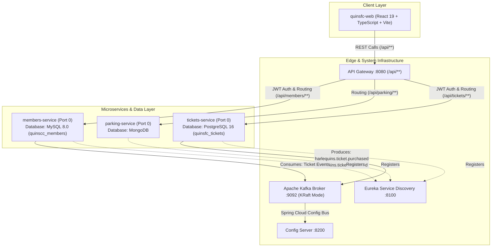

# Harlequins FC (HFC)

Harlequins FC is a full-stack sports club application built with a modern **Spring Boot Microservices** backend and a high-performance **React 19 + TypeScript + Vite** frontend.

---

## 🏗️ System Architecture



---

## ✨ Current Features

* 🎟️ **Matchday Ticketing Hub (`/tickets`)**: Real-time seat inventory browsing, category tier selection (Standard £45, East Terrace Premium £85, Quins Diamond VIP £175), and ACID transactional seat booking powered by `tickets-service` & PostgreSQL 16.
* 📱 **My Digital Passes Wallet (`/my-tickets`)**: Dedicated member pass wallet with gate pass QR/barcode rendering, active booking status, and instant ticket cancellation & refund processing.
* 🔄 **Login Intent Memory & Auto-Booking**: Smooth navigation preserving targeted match booking state across login redirects, automatically scrolling to match cards and triggering purchase dialogs.
* 🏟️ **Fixture Schedule & Results**: Comprehensive fixture list displaying competitions, venue details, kickoff times, and dynamic availability badges (*Available*, *Selling Fast*, *Low Stock*, *Sold Out*).
* 🅿️ **Stadium Parking Management (`/parking`)**: Real-time stadium parking space availability, vehicle registration, and unparking workflows powered by `parking-service` & MongoDB.
* 🔐 **Member Authentication & Security**: Member registration, login, Spring Security JWT issuance, edge JWT validation in `api-gateway`, and automatic downstream `X-User-Name` header injection.
* ⚡ **Event-Driven Kafka Architecture**: Asynchronous domain event stream publishing on `harlequins.ticket.purchased` and `harlequins.ticket.cancelled` Kafka topics, consumed by `members-service` for cross-service event processing and loyalty/profile tracking.

---

## 🛠️ Current Technology Stack

### 🎨 Frontend (`quinsfc-web`)
* **Framework**: React 19 (`react`, `react-dom` v19.2)
* **Build Tool & Bundler**: Vite 8 (`vite` v8.1) + `@vitejs/plugin-react` (React Compiler enabled)
* **Language**: TypeScript 6 (`typescript` ~6.0)
* **Global State Management**: Zustand (`zustand` v5.0)
* **Data Fetching & Cache**: TanStack React Query (`@tanstack/react-query` v5.101)
* **HTTP Client**: Axios (`axios` v1.18) with Vite dev-server `/api` proxy configuration
* **Form Handling & Validation**: React Hook Form (`react-hook-form` v7.82)
* **Routing**: React Router (`react-router-dom` v7.18)
* **UI Components & Carousel**: Mantine (`@mantine/core`, `@mantine/carousel` v9.4) & Phosphor Icons (`@phosphor-icons/react` v2.1)
* **Styling**: Vanilla CSS Modules & PostCSS (`postcss-preset-mantine`)
* **Testing**: Vitest (`vitest` v4.1) & React Testing Library (`@testing-library/react` v16.3)

---

### ⚙️ Backend (Microservices Architecture)
* **Java**: Java 21 JDK
* **Framework**: Spring Boot 3.5.3 & Spring Cloud 2025.0.1
* **Build Tool**: Gradle (with root & service wrapper scripts, Gradle 8.5)
* **Group**: `com.road.quinsfc`
* **Databases**: MySQL 8.0 (`quinscc_members`), MongoDB, and PostgreSQL 16 (`quinsfc_tickets`)
* **Security & Auth**: Spring Security + JWT Authentication (`io.jsonwebtoken` 0.12.6)
* **Messaging & Config Bus**: Apache Kafka (port 9092, KRaft mode)

#### Microservices Overview:
* **`config-server`** (Port `8200`): Centralized configuration management using Spring Cloud Config (`com.road.quinsfc.configserver`).
* **`eureka-server`** (Port `8100`): Service discovery & registration using Netflix Eureka (`com.road.quinsfc.eurekaserver`).
* **`api-gateway`** (Port `8080`): Gateway for routing (`/api/**`), security filtering, and CORS mapping (`com.road.quinsfc.apigateway`).
* **`members-service`**: Manages member accounts, registration (`POST /api/members/create`), login (`POST /api/members/login`), and Kafka event consumption (`com.road.quinsfc.membersservice`).
* **`parking-service`**: Manages stadium parking space reservations and availability (`com.road.quinsfc.parkingservice`).
* **`tickets-service`**: Manages match ticket inventory, seat bookings, digital passes, and Kafka event streaming (`com.road.quinsfc.ticketsservice`).

---

## 🚀 Running the Application Locally

### Prerequisites
Make sure you have the following installed on your machine:
* **Java 21 JDK** (configured in system `PATH` / `JAVA_HOME`)
* **Node.js** (v18.x or v20.x recommended) & **npm**
* **Docker / Docker Desktop** (for running local Kafka broker & PostgreSQL container via `docker compose up -d`)
* **MySQL 8.0** running locally on port `3306` (database schema `quinscc_members`)

#### Start Local Infrastructure (Kafka Broker & PostgreSQL)
Run the following command at the root of the repository to start Kafka & PostgreSQL:
```bash
docker compose up -d
```

---

### 1. Launching Backend Microservices

Launch the microservices in the following sequential order:

```bash
# Step 1: Start Centralized Config Server (Port 8200)
cd config-server
./gradlew bootRun   # On Windows: gradlew.bat bootRun

# Step 2: Start Eureka Service Registry (Port 8100)
cd ../eureka-server
./gradlew bootRun

# Step 3: Start API Gateway (Port 8080)
cd ../api-gateway
./gradlew bootRun

# Step 4: Start Members Service
cd ../members-service
./gradlew bootRun

# Step 5: Start Parking Service
cd ../parking-service
./gradlew bootRun

# Step 6: Start Tickets Service
cd ../tickets-service
./gradlew bootRun
```

> **Note**: You can inspect active microservices on the Eureka Dashboard by opening `http://localhost:8100` in your browser.

---

### 2. Launching Frontend (`quinscc-web` / `quinsfc-web`)

In a new terminal window, navigate to the web directory:

```bash
# Step 1: Navigate to web application folder
cd quinscc-web

# Step 2: Install dependencies
npm install

# Step 3: Start local development server
npm run dev
```

* Open your browser and navigate to **`http://localhost:5173`**.
* The Vite development server automatically proxies API requests matching `/api/**` (such as `/api/members/login` and `/api/tickets/availability`) to the API Gateway running at `http://localhost:8080`.

---

### 3. Frontend Commands & Scripts

Inside the web directory, the following npm scripts are available:

```bash
npm run dev      # Starts Vite local dev server with HMR
npm run test     # Runs unit tests using Vitest
npm run build    # Performs TypeScript type-checking and builds production bundle
npm run preview  # Previews production build locally
npm run lint     # Runs ESLint checks
```

---

## 📐 Project Structure

```
HarlequinsFC/
├── api-gateway/            # Spring Cloud Gateway (Port 8080)
├── config-server/           # Spring Cloud Config Server (Port 8200)
├── eureka-server/           # Netflix Eureka Service Discovery (Port 8100)
├── members-service/         # Member Management Microservice (MySQL 8.0)
├── parking-service/         # Stadium Parking Microservice (MongoDB)
├── tickets-service/         # Match Tickets Microservice (PostgreSQL 16 + Kafka)
└── quinscc-web/             # React 19 + Vite Frontend Application
    ├── src/
    │   ├── assets/          # Static images, logos, media
    │   ├── components/      # UI components & pages (Home, Squad, Fixtures, Tickets, MyTickets, etc.)
    │   ├── hooks/           # Custom React hooks & TanStack Query mutations
    │   ├── services/        # API services and Axios clients (authApi, ticketsApi)
    │   ├── store/           # Zustand state management (auth store, tickets store)
    │   └── App.tsx          # Application routing setup
    └── package.json
```
